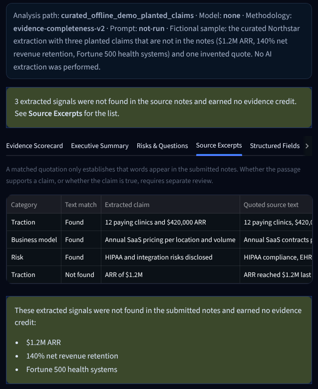
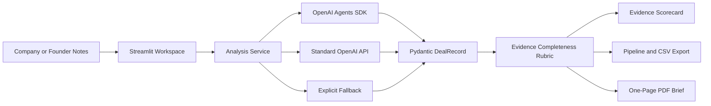

# DealFlow AI — Private-Market Diligence Workspace

DealFlow AI turns unstructured company notes into a structured evidence review: what the notes document, what is missing, and which diligence questions to ask next, with a CRM-ready record and a one-page brief.

**[Launch Streamlit demo](https://ai-deal-pipeline-assistant-iaersbqy54j5dbbknbsui8.streamlit.app/)** · [View automated checks](https://github.com/robtabamo9292/ai-deal-pipeline-assistant/actions)

## Case study: a score should not trust its own extraction

**Problem.** An AI extraction can state a metric the source never contains, and a score built on that extraction looks credible.

**Finding.** I tested it. Four claims absent from the notes ($2.4M ARR, 140% net revenue retention, Fortune 500 CFOs and a competition risk) raised the evidence score from 6 to 28.

**Fix.** A signal now earns credit only when the notes back it: every figure it states must appear in the notes (`$420K` matches `$420,000`) together with at least one of its words. Unsupported signals are kept for review, flagged in the app and the CSV export, and add nothing to either the evidence score or record completeness.

**Proof.** [`tests/test_source_support.py`](tests/test_source_support.py) asserts that invented signals and changed figures earn zero, and the **Preview invented-claim check** demo shows it without an API key: three planted claims are flagged, an invented quote is marked not found, and the score stays at 68.



### Review in two minutes

1. Open the demo and select **Preview fictional case (no API key)** to see the curated Northstar extraction scored against its notes.
2. Select **Preview invented-claim check (no API key)**: the same notes with three planted claims. Check the warning and the **Source Excerpts** tab.
3. Inspect the evidence scorecard, risks and questions, and the PDF brief.
4. Both previews are **manually curated from a fictional source**; neither runs a live model or verifies facts externally. To run real AI extraction locally, configure an OpenAI API key and use **Analyze deal**.

**Scoring disclosure:** The rubric is a conservative heuristic for research triage, not a measure of investment quality, independently checked evidence, or an institution-certified diligence process. Semantic claim verification and live-model accuracy benchmarking remain future work.

The project demonstrates an end-to-end AI workflow for venture sourcing, private-market screening, analyst research, and business-operations automation.

## Product workflow

1. Load a sample company or paste unstructured notes.
2. Extract structured company, customer, traction, funding, risk, and business-model evidence.
3. Measure diligence evidence completeness across nine categories.
4. Identify the weakest evidence areas and generate targeted diligence questions.
5. Add the company to a session-based pipeline.
6. Export CRM-ready CSV data or a one-page PDF brief.

## Important scoring distinction

The displayed score is an **evidence-completeness score**. It measures how much decision-useful diligence information is present in the submitted notes.

It does **not** measure investment quality, expected returns, valuation attractiveness, or the probability that a company will succeed.

The deterministic rubric evaluates documented evidence across:

- Founder and team
- Market
- Product and differentiation
- Traction and product-market-fit evidence
- Customer and ICP clarity
- Business model and unit economics
- Go-to-market evidence
- Competition
- Material risks

Missing disclosures should receive zero points under the revised conservative heuristic. The scoring method is documented and evaluated with an additional set of adversarial, negative, and keyword-stuffing tests. It is not a substitute for semantic claim verification.

**Source-backed signals only.** Traction, customer and risk signals produced by the model earn points only when the submitted notes back them: every figure in the signal must appear in the notes (`$420K` matches `$420,000`), together with at least one of its words, and a signal without figures needs most of its words in the notes. Signals that fail this check are kept for review, listed in the Source Excerpts panel and the CSV export as unsupported, and score zero. A hallucinated metric therefore cannot raise the score.

## Key features

- Unstructured company-note intake
- Public sample mode using built-in demonstration companies
- Standard OpenAI and optional OpenAI Agents SDK analysis paths
- Pydantic-validated structured records
- Deterministic evidence-completeness scorecard
- Source-support check: extracted signals not found in the notes are flagged and earn no credit
- Source Excerpts review panel: exact source-text matching and unresolved human-review status (not proof of semantic support)
- Explicit analysis-path, model, fallback, prompt-version, and timestamp metadata
- Targeted diligence questions based on evidence gaps
- Session-based deal pipeline
- CRM-ready CSV export
- Institutional one-page PDF investment brief
- Deterministic evaluation set and results
- Mocked AI and failure-path tests
- Ruff linting and GitHub Actions CI

## Architecture



The language model extracts and organizes information. Python then checks each extracted signal against the source notes and applies a transparent evidence rubric to the signals that pass. AI execution provenance is retained so users can see which path produced the record and whether fallback logic was used.

## Public sample mode

The app includes built-in sample notes for public demonstration. A fictional healthcare workflow company is included so users can test the full workflow without relying on confidential company information. Two offline previews use it: a curated extraction scored against its notes, and the same extraction with three planted claims to show the source check.

The public samples are demonstrations, not verified investment research.

## Local setup

```bash
git clone https://github.com/robtabamo9292/ai-deal-pipeline-assistant.git
cd ai-deal-pipeline-assistant
python -m venv .venv
source .venv/bin/activate
python -m pip install -r requirements.txt
cp .env.example .env
python -m streamlit run app.py
```

Add your API key and preferred models to `.env`:

```env
OPENAI_API_KEY=your_api_key_here
OPENAI_MODEL=gpt-6-luna
OPENAI_AGENT_MODEL=gpt-6-luna
OPENAI_REASONING_EFFORT=low
```

The default model is `gpt-6-luna`, OpenAI's replacement for `gpt-4o-mini`, which shuts down on January 14, 2027. Luna is a reasoning model; the app sends it a reasoning effort (default `low`, enough for extraction from short notes) instead of a temperature. Older models such as `gpt-4o-mini` still work by changing `OPENAI_MODEL`, and the app adjusts the request settings automatically.

When no API key is configured, AI extraction returns an explicitly labeled **Not analyzed / Not scored** record. The one-click fictional offline demo is separate, with manually curated fields clearly labeled as such.

## Tests and evaluation

Install development dependencies:

```bash
python -m pip install -r requirements-dev.txt
```

Run linting, tests, and the deterministic evaluation:

```bash
python -m ruff check app.py src tests eval
python -m pytest -q
python -m eval.run_eval
```

The automated test suite covers:

- Evidence-score boundaries and status bands
- Zero-evidence behavior
- Negative traction evidence
- Pydantic validation
- JSON extraction and malformed responses
- Missing API-key fallback behavior
- Mocked OpenAI output
- Agents SDK failure and fallback routing
- Export provenance fields
- PDF generation
- Adversarial negation, keyword-stuffing and source quotation matching
- Zero credit for signals absent from the notes, including changed figures
- Labeled lists ("Competition: A, B, C") and plural keywords count as disclosures; keyword-only and "none identified" lists do not
- Headless Streamlit smoke tests that click both offline demos

The evaluation set contains twelve labeled examples, including complete, partial, minimal, negative, keyword-stuffing and explicitly missing information. The revised expected bands and category-level zero-credit checks reflect more conservative scoring. These do not evaluate live model factual accuracy.

## Repository structure

```text
.
├── app.py
├── src/
│   ├── analysis_service.py     # chooses the AI path and records provenance
│   ├── agent_workflow.py       # OpenAI Agents SDK path
│   ├── llm.py                  # standard OpenAI path
│   ├── model_config.py         # model selection and request settings
│   ├── intake.py               # keeps metadata out of scored notes
│   ├── schema.py               # Pydantic models
│   ├── verification.py         # quote matching and signal source-support
│   ├── scoring.py              # evidence-completeness rubric
│   ├── demo.py                 # curated fictional offline demo
│   ├── sample_data.py
│   ├── export.py               # CSV export with formula-injection guard
│   ├── memo.py
│   ├── memo_schema.py
│   ├── memo_pdf_v2.py          # one-page PDF brief
│   └── ui/
│       ├── components.py
│       ├── memo_view.py
│       └── styles.py
├── tests/
│   ├── test_core.py
│   ├── test_reliability.py
│   ├── test_keyword_disclosures.py
│   ├── test_source_matches.py
│   ├── test_source_support.py
│   ├── test_model_config.py
│   └── test_app_smoke.py
├── eval/
│   ├── eval_set.csv
│   ├── eval_results.csv
│   ├── run_eval.py
│   └── README.md
├── data/
│   ├── sample_inputs.csv
│   └── sample_outputs.csv
├── requirements.txt
├── requirements-dev.txt
├── pyproject.toml
└── .github/workflows/tests.yml
```

## Privacy and limitations

- Notes submitted through an enabled AI path are sent to the configured OpenAI service.
- Do not submit confidential, regulated, or personally identifiable information without authorization.
- The application does not independently verify claims, financial figures, customers, funding rounds, or market data.
- The evidence score measures documentation completeness, not company quality.
- The displayed record completeness metric is an uncalibrated coverage proxy, not extraction precision, semantic accuracy, or factual truth.
- The current pipeline is session-based and is not a permanent CRM or database. Repeat analyses with the same company and notes replace the corresponding in-session record.
- The offline demo uses manually curated fictional fields and does not validate the live AI model.
- Missing-information and substring false positives are mitigated by conservative lexical rules, but these rules are not a full natural-language entailment or citation validation system.
- The source-support check is lexical and errs toward withholding credit: a signal paraphrased with different words (for example "growth" where the notes say "grew") can be flagged unsupported even when the notes back it. It confirms words and figures are present, not that the claim is true.
- Several rubric categories still award points from keywords in the notes, so evidence described in unusual wording (such as "ex-Stripe payments lead" with no mention of founder or experience) can be missed. Classification fields such as sector and description are model-inferred and are not source-checked.
- All generated analysis requires human review and primary-source diligence.

## Project status

The application is functional and includes structured extraction, explicit fallback handling, evidence scoring, diligence generation, public samples, pipeline tracking, CSV export, PDF briefing, automated tests, deterministic evaluation, linting, and continuous integration.
